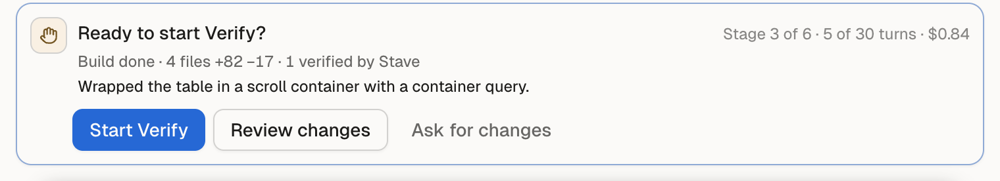
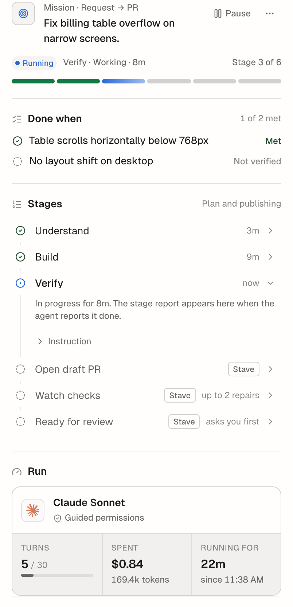

# Agent Runs And Their Stages

## Summary

When you assign work to an agent, Stave runs it stage by stage. An agent with
a **workflow** follows its stages — asks the agent for each AI stage, opens the
draft pull request, watches its checks, marks it ready — and stops only where
its **Check in with me** setting says, or when something needs you. An agent
without a workflow runs one stage that plans its own steps.

The product calls one a **Run**; inside Stave the engine is called an *agent
run* (`AgentRun`). The product shows the agent, its stages and its result.
Legacy runs, started from playbooks before playbooks folded
into agents finish as they are, and their surfaces keep working.

## Hand Off A Goal And Leave It

You give an agent an outcome; the run carries it to a checked result and
calls you only when it needs a decision.

**Set up once**

1. Give the agent **Permission: Auto** (Agents → the agent → **How it runs**).
   With any other permission the run stops at each approval card.
2. Add a workspace check: Settings → Repositories → **Scripts Manager** → an
   **Action** that runs your checks, for example `bun run typecheck && bun test`
   ([Workspace Scripts](workspace-scripts.md)). With one configured, a write
   agent's run is done only when Stave runs that action itself and it passes.
3. For work you want reviewed before it counts as done, add a review stage
   ([Bigger goals](#bigger-goals)).

**Start**: Agents → the agent → **Assign…**, write the outcome and what proves
it, pick where it works, **Assign**. Or pick the agent in the composer and
send.

**What happens without you**

| Situation | What the run does |
|---|---|
| The agent edits files or runs commands | The provider's classifier allows safe actions (Claude auto mode, Codex auto-review); only what it cannot decide asks you |
| The run uses its turns | It halts on **Limit reached**; **Extend (+10 turns)** continues the same session |
| The agent asks a question | The card stays until you answer, across app restarts; your answer continues the run once |
| The agent says it is done | With a workspace check, done only when Stave's own check passes on the final work (**Met · checked by Stave**) |
| The next step waits for pull request checks, a review or a time | The run waits without using turns and continues when it happens |
| The subscription hits its usage limit | The run waits for the reset and continues on its own |

**When it needs you**: the run reads **Needs your answer** (answer the card)
or **Halted** with the reason (**Retry stage**, **Extend**, or **Take
control**). Fleet's **Action required** and a notification point to it. Every
other state continues on its own.

### Bigger goals

One run can take several related fixes at once. A passing check proves the
check passes, not that the change is right: a change can satisfy a check
without fixing its cause. An agent that edits files and has no workflow of its
own, such as Implementer, does this by itself: its **Review before done**
setting (Agents → the agent → **Workflow**, on **When behavior changes** by
default) adds Work → Review → Fix review findings. The independent review stays;
the final repair is skipped only after a passing review of unchanged work with
no required checks or sign-off left. Research conclusions and artifacts are
reviewed even when there are no code commits. To shape the
stages yourself, give the agent three stages (Agents → the agent →
**Workflow** → **Add stage**):

1. **Implement**: do the assignment, run the workspace check, commit.
2. **Review**: **Done by** Reviewer, with **Work on the commit checked out when
   it starts** on. Instruction: review the committed change against the
   assignment without changing files. Done when: `The review lists each defect
   with file, line and reason, or says it found none.` Write a Done when the
   reviewer can meet by reporting; a reviewer asked to make defects disappear
   cannot, and its task halts.
3. **Fix review findings**: fix each defect at its cause, run the workspace
   check, commit. Done when every defect is fixed and the check passes.

The Reviewer runs on the other provider when it can and reports its findings
as its result. An agent may always call the agents its own workflow names for
a stage, even when its **Can call** list leaves them out. A criterion an
earlier stage met stands; the last stage must report met only what is still
open, and its prompt says which.

While a stage waits for another agent, the run reads **Running · Waiting ·
Delegated work**. A delegated run that reports a required criterion unmet
ends (**Criterion unmet**) instead of halting, and the waiting stage wakes
with its report. A delegated task that stops for your answer or a blocked
stage keeps the run waiting: open it from **Subagents** and answer or retry
it there.

For goals with separate parts, assign **Lead**, which splits the work across
agents and checks each result before it reports.

## When To Use It

- The work has a shape you repeat: reproduce, fix, verify; or validate, open a
  pull request, get the checks green, request review. Give an agent that
  workflow (Agents → an agent → **Workflow**) or use a built-in that has one
  (Debugger, UI Polisher, Shipper).
- You want the task to keep moving while you do something else, and to be told
  only when it needs a decision.
- For a one-off question or a small edit, send a normal message instead. For
  scheduled work that starts a new task each time, use a
  [schedule](automations.md).

## Before You Start

- The task runs on Claude or Codex.
- Stave's local tools are on (Settings → MCP → Local MCP Server). The agent
  reports each stage through them; without them a run cannot start.
- For workflows with pull request stages, the GitHub CLI is signed in
  (`gh auth login`).

## Quick Start

1. Pick an agent in the composer's selector (`Alt+P` → **Agents**), or run
   **Assign to an agent…** from the command palette.
2. Type the outcome, for example
   `Fix the billing table overflow on narrow screens.`, and send.
3. The run starts at once. With more than one stage, the status line above the
   composer shows the stage track and the Task panel's **Progress** names the
   workflow (`Workflow: Reproduce → Cause → Fix`) and lists each stage and its
   report. A one-stage run shows the agent's own plan instead: its latest to-do
   list (Claude's to-do tool, Codex's plan updates) as **Plan 3/5 · Now: Run
   the checks** on the status line and Fleet, between turns too. Until the
   first plan arrives the line says **Planning…**. A single step counts.
   **Progress** updates the checklist as the agent works and keeps the saved
   plan between turns; the report carries the final plan. Multi-step work uses
   the provider's plan tool when available, otherwise a short written plan.
   A missing plan tool does not block work, and a simple answer needs no plan.
4. The shelf summarizes the task's subagents, for example **Implementer
   running · Reviewer done**, or **Reviewer needs you** when a delegated Agent
   waits for a person (a question, an approval, or its own run halted or
   paused); open its task to answer. **Progress** and **Subagents** show their
   latest step or tool and a one-line result in plain text: a delegated Agent
   run's result is its last stage's outcome, and the full report stays on hover
   and in its task. Saved tool parts preserve these summaries after completed
   turn events are compacted.

## Interface Walkthrough

### Entry Points

- The composer's selector, **Agents** section, then send.
- **Assign to an agent…** in the command palette, or `!assign` in the
  composer.
- **Who** in [Workspace Kickoff](workspace-kickoff.md): pick an agent and
  click **Assign**.

### What a run will do

When the next send will start an agent run, the composer says **Sending this
starts an agent run** with four lines, and the Run panel's header repeats them
as **What this run does**:

- **Where**: the task's workspace, its branch, and whether it is the
  repository folder or the run's own worktree.
- **May change**: an Auto agent edits files and runs commands with the
  provider's auto mode deciding each action and asking when it cannot. The
  line follows the options the run applies: on a Codex without its reviewer
  for Auto, the run falls back to approvals off, and the line says it edits
  without asking. (Codex's managed settings or account can still turn the
  reviewer off when a turn starts; the turn then runs the same way.) Other
  agents edit without asking; a Read only agent changes nothing. Writes outside
  the repository, credential files and irreversible remote actions still come
  to you. Publishing steps (such as **Open draft PR**) say whether they are
  allowed from the start or wait for your sign-off.
- **Done when**: the assignment, or each stage of the workflow, and the
  workspace checks Stave runs itself, with whether every script must pass or
  one is enough. For a write agent whose workspace has action scripts, the
  default check (one passing script) is named too.
- **Comes back to you**: the check-in level, the stages that ask first,
  questions it cannot settle, and the turn limit (it pauses there until you
  extend it) and usage limits.

### Check in with me

An agent's **Check in with me** decides where a run waits for you between
stages:

- **Only when stuck** (default): never, unless a stage is blocked or stuck.
  Assigning the work is the go-ahead for the workflow's publishing stages.
- **Before publishing**: before the stage after a plan, before a publish
  stage and before **Ready for review**; every stage that acts outside this
  machine asks first.
- **Every stage**: before each stage after the first.

A run records its permission at start, from the agent that was assigned: an
**Auto** agent's runs use the provider's classifier (Claude auto mode, Codex
auto-review when available); every other permission runs on your own provider
settings, and a read-only agent stays read only. In every mode your sandbox,
deny lists, credential protection, file access and network setting stay as you
set them. **Auto** on Claude uses Claude's native permission classifier,
without bypassing permission checks. When the classifier cannot decide or Auto
is unavailable for the model or account, Claude hands the call to Stave. A
trusted tool, a read or edit inside the repository, or a Stave tool that needs
no approval still runs without asking; anything else asks, and the Run waits
for that approval. Codex Auto uses native auto-review when available: `on-request`
approvals with the `auto_review` reviewer, and Stave trusts its decision. When
auto-review is not available (an older or prerelease Codex, a managed policy
that does not allow it, a Codex that refuses the request, or a thread that
reports another reviewer), the turn runs as Codex Auto did before: approvals
`never`, and the run says so once.
Either way file access is at least the workspace, or your full access; network
stays as set; and Stave's own tools run without asking. A saved agent's
**Manual** or **Guided** permission does not change Auto on either provider;
a **Read only** agent stays read only. **Guided** and **Your settings** keep
their existing mapping.

Approval cards keep their time limit: after 45 minutes Stave declines an
unanswered approval and the turn continues. In a
[delegated task](./delegated-tasks.md) the host declines it after a few minutes.

A native question in a Run stays on the task until you answer it, including
after its 45-minute callback timeout, a turn ending, or an app restart. The
Run shows **Needs your answer · Question** (**답변 필요 · 질문**) and waits
without nudging or declaring the stage stuck. After the callback timeout the
native turn ends; your answer starts one reply turn in that Run's current
stage. Answering the card again does not send another reply. Before the
callback ends, an answer goes directly to the waiting provider. This applies
to Claude's question tool and Codex's native user-input request; approval
cards and questions outside a Run keep their existing behavior.

### Run states

A Run wears one of six badges, the same on the task's tab mark, the Fleet
card, the Task panel's **Progress** tab and the run line, with a subtitle
that says what it stands on. Every word is in English and Korean.

| Badge | Korean | What it means | Subtitle |
|---|---|---|---|
| **Running** | 실행 중 | A turn runs or is about to, or the Run waits between turns for an outside event or a usage reset | none; **Waiting · PR checks** (any event); **Waiting · Usage limit (resumes 3:05 PM)** |
| **Needs your answer** | 답변 필요 | A question or an approval card is open, a stage sign-off included | **Question**, **Approval** |
| **Paused** | 일시정지 | You paused the Run or took over; it has not ended | none; **Taken over** |
| **Halted** | 멈춤 | Nothing continues on its own until you act; it has not ended | **Blocked** (a blocked or stuck stage), **Recovery needed** (the task or its runtime changed), **Wait expired**, **Usage limit** (no reset time), **Limit reached** |
| **Completed** | 완료 | The Run finished | none |
| **Stopped** | 중지됨 | The Run ended before finishing: you stopped it, or Stave did because its deadline passed or the task became unavailable (the reason card says which) | none |

Each badge has its own state color, set by the theme: Running and Needs your
answer never share a color, even in themes whose accent and warning are the
same hue, and Needs your answer and Halted share the attention color with
different glyphs. A Run's waits keep the neutral tone. A question or approval
belongs to the lead task's turn, so a Run reads **Needs your answer** while
any such card in the lead task's conversation is unanswered, and goes back to
its badge once you answer the last one. The run line, the Task panel, the
task's mark, the Fleet card and Agent activity all read the cards the same
way, so answering one of two approvals leaves every surface on **Needs your
answer**.

### Agent run line

The run line of the composer shelf, above the prompt input, for as long as an
agent run is going, between its turns included (see
[Turn Activity](turn-activity.md#the-composer-shelf)):

- The current stage and what it is doing — a plain phrase such as
  **Running the tests** while a turn runs, or what it waits for and for how
  long, with the Run's badge, such as **Needs your answer · Approval · 8m**. A stage turn that stalls,
  steers, retries or fails says so instead, as the turn's line would:
  **Stalled · No updates for 2m** with how to stop or interrupt it.
- The stage track, one line high: the stages behind the run fill it and the
  head names the stage in progress and where it stands (`Verify 3/6`). When
  the composer is too narrow for the track, the line says `3/6` in words. A
  hand marks a stage that asks you first.
- **Take over** pauses the agent run so your replies are your own; **Resume**
  hands the task back. A reply without Take over guides the current stage and
  the agent run carries on.
- The panel button opens the Task panel's **Progress** tab; the details toggle
  unfolds the current turn's rows.

### Sign-off

When a stage waits for you, a card appears where tool approvals appear:
**Ready to start Verify?**, with what the previous stage produced (files
changed, evidence Stave verified) and its summary. Its corner shows the stage,
the turns used of the limit and what the agent run has spent, such as
**Stage 3 of 6 · 5 of 30 turns · $0.84**.

- The primary button names what happens, such as **Start Verify** or
  **Mark ready for review**.
- **Review changes** opens [Review](review-mode.md) on the stage the sign-off
  is about: its changes since its start commit, apart from anything changed
  after it, its checks, and **Sign off** or **Ask for changes** in one place.
- **Ask for changes** sends a note and runs the last AI stage again.

### Agent run in the Task panel

The **Progress** tab of the right rail's Task panel, while the task has an
agent run (a task without one shows its flow there):

- The goal, the Run's badge and subtitle ([Run states](#run-states)), and
  the stage track.
- **Done when**: the acceptance criteria, each **Met · checked by Stave** (a
  workspace check Stave ran and saw pass on the final work), **Met · agent
  reported**, **Not met** or **Not verified**. A workspace check criterion
  never reads as met on the agent's word. Below them, **Checked by Stave**
  names the checks Stave saw pass, a workspace check by its action name.
- The **Run** card's permissions line is short (**Auto permissions**); hover it
  for what Auto does on that provider.
- **Stages** as a timeline. Open a stage for its summary, decisions with their
  reasons, evidence (**Verified by Stave** first, with **Show** to jump to the
  tool call in the transcript), links, and the instruction it ran with.
- **Retry stage** and **Skip stage** on a blocked or stuck stage; **Pause**,
  and **Stop run** in the **⋯** menu.
- **Run**: who runs the agent run — the provider's mark, the model by name and
  the permissions — above its figures: **Turns** against the budget (the bar
  turns amber close to the limit, where the agent run halts), **Spent** (the
  cost and tokens the provider reported; tokens alone for a provider that
  reports no cost), and how long it has been running. A note says when a
  turn reported no usage.
- The task's wake-up, the other thing that can start turns on the task.

The task's subagents are in the **Subagents** tab next to it.

### Acceptance and check evidence

A finished provider turn or subagent does not complete a stage by itself. The
current turn must report completion, and any required criteria authored for
that stage must be reported **Met**. Criteria for the overall goal are checked
at the final stage; a Build stage can pass to Test while future checks are
still pending. At the final stage a goal criterion an earlier stage already
met stands unless the final report says otherwise; the others must be
reported **Met** there. Host checks from earlier stages remain valid only for
the current workspace revision; edits require another admitted check. A report
holds up to 240 criteria, covering all 12 stages' 20 criteria. Optional checks
can stay unverified without blocking required work. A simple answer or documentation stage requires no shell check
unless its workflow explicitly requires one. Manual sign-off and Skip remain
available.

Workflow stage criteria support `text`, optional `required` (true by default),
optional `verification` and, on AI stages, an optional `mode` (`all` or
`any`) for `stave-check` criteria. AI stages use `agent-report` for the agent's
assessment, or `stave-check` for a host workspace script result. A required
`stave-check` cannot be satisfied by an agent-reported **Met**. Run script
action stages keep the same check behavior, including when verification is
omitted. A bound Run script action checks its admitted definition before execution
and accepts a successful result only when its receipt names that same definition.
Other action stages cannot require a workspace script check. At admission, AI-stage `stave-check` criteria in custom and saved workflows also bind the configured action definitions; an existing default criterion is upgraded in place without changing `required: false`. Explicit `scriptIds` restrict the accepted actions; omitting them accepts any configured action. With `mode: "all"`, every listed action must pass; without `mode`, any one may. Missing action IDs, no configured actions for an explicit check, and delegated runs with AI-stage `stave-check` criteria are refused at start because those checks cannot be executed.

A workspace check saved without a `mode` keeps its original meaning: any one
of its actions that passes on the final revision meets it. A check whose
`mode` is `all` is met only when every listed action has its own passing result
on that same final revision; a pass on an earlier revision does not count, and
a script's later failure replaces its earlier pass. Checks added in the stage
editor (**Workspace checks** on an AI stage) pick their actions from a
searchable list of the workspace's action scripts and default to **All must
pass**; **Any one passes** is the other choice. Editing a saved check's scripts
keeps its choice, so a check saved without one still needs any one; a name the
editor generated follows the new list, and any other name stays. Wherever Stave shows such a criterion (Done when
on the result, the Run panel's checks and the sign-off card's summary), it adds
how many of the criterion's actions passed and which ones, for example
`Stave checks: 1 of 3 passed (setup)`, so a passing setup action is never
read as passing tests. A check that needs all of them also names the actions
still needed, for example
`Stave checks: 1 of 2 passed (lint); still needed: test`, and a stage blocked
by it names the first action that has not passed.

Read-only Agents cannot execute host action stages. Pausing, taking over,
cancelling or releasing the Agent withdraws permission for further work as soon
as the request arrives, including while the host is still reading task state.
It interrupts an action script and prevents further source-control operations.
A command already sent may finish; inspect any side effects before
retrying. Resuming does not automatically replay an interrupted action.

A primary write agent's implicit Work stage, and the last AI stage of the
built-in Implementer, Debugger and UI Polisher workflows, require **Workspace
checks pass** when the workspace has configured action scripts. Researcher,
Reviewer, Lead and read-only agents do not get this default. With one action,
that script is required; with several, all IDs are listed in sorted order and
any one may satisfy the criterion (the default carries no `mode`). Script configuration currently has no
verification-role marker. The criterion and hashes of the resolved execution definitions stay with the workflow on stage retry. A new run, including **Run again**, discards incoming hashes and binds the current host-resolved definitions. Changing commands, working directory, shell or configured environment after admission makes the tool refuse that script.
Without configured actions, completion remains agent-reported.

The agent calls `stave_run_workspace_script({ scriptId })` before reporting.
Stave runs the configured action, records its exit status, duration, bounded
output, the definition hash, the executed commands and before/after revisions on that stage, and displays the host check
in its evidence. Required checks need exit 0 and known matching source,
completed, report and final workspace revisions. A missing, failing or stale
check blocks completion with the script ID and tool to run before reporting
again. Write-capable primary AI-stage turns and the exact CI repair turn started
by **Watch checks** may run it; read-only, delegated, non-run and other action
callers are refused. A CI repair commits its fix, reruns the inherited frozen
checks, then ends without a stage report. Stave checks that evidence before
continuing publication. The latest result for each admitted script supersedes
its earlier results, including a later failure. Where a criterion allows
alternative scripts, another current passing alternative can still satisfy it.
Each stage retains up to 50 receipts, preserving the latest result of every
script before keeping older history. Repeated checks cannot erase another
script's failure. After 50 different scripts, that stage can rerun those scripts
but refuses additional identities before execution; use another stage for them.
A later AI stage can renew inherited evidence with the same admitted script;
completion, stage briefings and **Done when** use the same evidence.
Later stages can reuse a successful check across staging
or a commit only when the fingerprint proves that paths, modes and file contents
are unchanged. Unknown, conflicted or unsupported content cannot establish that
equivalence. Content fingerprints use actual worktree bytes, including line endings,
rather than normalized Git blobs. They are bounded to 20,000 paths and 128 MiB;
larger trees need the final commit before the check instead of reusing a pre-commit
result. The original check itself still needs matching source and completed
revisions; an AI report and independent review still require strict revision matches.
Before each push, pull request creation or ready-for-review update, Stave
rechecks inherited required checks against the current files. If a local commit
hook changed those files, it stops before the next remote update. Restore the
checked work before retrying, or start a new run to verify the changed work.
While Watch checks or Ready for review only polls remote state, it does not
rehash the workspace on every tick. Verification remains required before each
remote update and when the run completes.
Each run allows one script at
a time, with the same 30-minute cap as a Run script stage. Pause, Stop and Cancel abort the script process, including admission still reading its configuration.
Host shutdown also fences script requests queued before shutdown, so a delayed
read cannot start a process afterward. Unknown revisions and checks that modify the tree return an explanation, and a report whose revision cannot be read stays blocked with that reason. Admission reads no git snapshot, so the default check is never dropped because of the workspace state; only an invalid default-criterion insertion is skipped with a timeline/report notice, and that notice survives stage retry. Workspace renames do not change a script definition hash.

Check evidence separates **Provider result** and **Agent reported** claims from
successful host checks of unchanged work. A tool response without a structured
process exit code has an unknown exit status, even if its text says it passed.
Claude tool errors remain failures; Codex's structured process exit code is
preserved. A Run script check captures the workspace state before and after
the actual process. Required checks need exit 0 and matching known revisions.
Changes during or after the check make its evidence stale; unavailable or
bounded workspace snapshots show **Current work unverified**. Viewing a report
never stamps a new revision onto an older command. Historic records without
process or revision provenance remain unverified.

### Transcript

A quiet divider marks every turn an agent run started, with the reason, such as
**Stage 3 · Verify** — started automatically after Build reported done. An
agent run with a workflow gets the same dividers; a one-stage run has none.

For a user message that starts a run, the bubble shows the words you wrote and
a folded **Full prompt sent to the agent** row shows the complete prompt Stave
assembled, including its instructions. A run follow-up with no user wording
appears in its own **Stave's follow-up to the agent** row. Open either row to
read the Markdown prompt or copy it; the row says when the prompt is still
being prepared.

### Agent run report

When an agent run ends, its report is shown in the Task panel's **Progress** tab
and under **Agent run report and actions** in **Outputs**. The Outputs disclosure
starts collapsed so saved task answers stay easy to scan. The report contains
outcome, figures (duration, stages, turns, verified evidence, what it spent), links,
decisions, what is still open, what was left behind, any account-pool switches,
every event wait (when it began, each wake, how it ended), and how much the
agent run needed you. **Copy Markdown** and **Add to PR description** act on it, and
**More** holds the rest:

- **Save decisions to memory**, as memory candidates you review.
- **Share to Slack…**: paste a thread link (the one in the assignment is
  filled in) and the agent run's task posts the report there once, as a reply,
  with your Slack tools. It changes no files and waits while the task is in a
  turn.

### Agent performance

The **Performance** tab of **Agents** (also opened from **Agent performance** in
the Fleet header and the Stave menu, or the command palette) compares ended runs
across workspaces over 7, 30 or 90 days. It shows completion
rate, median completion time, reported spend with cost coverage, follow-ups and
stop reasons. Expand an agent row to inspect its recent reports.

Both completions without a recorded change request and completions after a
change request count toward completion rate. Completion alone does not verify
quality. The sample is limited to ended runs among the 200 most recently created
agent runs; ordinary chat turns appear in the task's **Outputs** instead.

See [Agent performance and task outputs](results.md) for metric definitions,
sample limits and examples of when each screen helps.

### Fleet and notifications

- A sign-off, a blocker or a stuck stage appears in Fleet's attention list with
  approvals and questions. A sign-off can be given from the row.
- Fleet cards show the agent run's stage track (a one-stage run: **Plan 3/5**)
  and what it has spent, and the
  work queue puts the workspace in **Action required** or **In progress**.
- Stave notifies once when an agent run asks for a sign-off, is blocked, is stuck,
  stops waiting for an event that did not come, or completes. Waiting for an
  event and waking on it send no notification. **Settings → General → Run Sign-off Reminders** sets when
  a waiting sign-off reminds you again, batched into one notification.

## Common Workflows

### Steer a running agent run

- Reply in the task to add guidance; the stage continues with it.
- Click **Take over** to stop the agent run's turns while you work yourself,
  then **Resume** to hand it back.

### Recover a stuck or blocked stage

1. Open the Task panel's **Progress** tab; the stage says why it stopped.
2. Answer the question in the task, or fix what it names.
3. Click **Retry stage**, or **Skip stage** to move on.

## Files And Data

- Agent runs are stored in Stave's local database with their stage records and
  events. Nothing is sent anywhere except what the stages themselves do (pull
  requests on GitHub, messages through your own tools).
- The agent's workflow is copied into the run when it starts; later edits to
  the agent do not change a running run.
- Each stage record keeps the paths the stage changed since its start commit
  (tracked changes, committed or not, and untracked files; up to 200), read
  when the stage reports. Review uses them to tell the stage's own changes
  from later ones. An untracked file that existed before the stage, or a
  later edit to one of the stage's own files, cannot be told apart. Stages
  recorded before this have no list.

## Limitations And Advanced Options

- Agent runs run on Claude and Codex tasks, one agent run per task at a time.
- Before starting a run, Stave waits for its workspace changes to be saved and
  reads the current task state. If startup is refused or saving fails, the
  prompt is kept for retry and no ordinary turn is sent automatically.
- When an Agent-mode message includes files, images or task/context attachments,
  the composer explains before sending that it will run as a single turn and
  automatic agent execution will not start. Attachments in staged prompt items
  count too. Text-only Lens annotations keep the normal run path. Messages to an
  already active run remain user turns that guide that run.
- An agent run uses the task's current model. If you change it, the agent run
  pauses until you accept the new runtime for the remaining stages.
- Pull request stages use the GitHub CLI and watch every check reported for
  the pull request. **Open draft PR** commits what was left and pushes the
  branch before it opens the pull request, or before it continues one the
  branch already has, so a rerun after **Ask for changes** reaches it too.
  **Ready for review** pushes the workspace's latest commits first when the
  pull request lacks them.
- If Stave quits while a stage's turn runs, the stage continues with a new turn
  after the restart; that turn does not use up the stage's one reminder.
- If the provider fails for a reason that passes (a timeout, a dropped
  connection, an overloaded or unavailable service), the stage retries after
  30 seconds, then 2 minutes, then 5 minutes, without using up its reminder.
  Each retry is a turn and checks what the failed turn already did. After the
  third retry fails too, the stage is **Stuck** with the provider's error;
  **Retry stage** once the provider is back. A usage limit is not a provider
  failure: it waits for the reset instead.
- The turn limit comes from the agent's `tools.maxTurns`, or defaults to 30,
  capped at 100. At the cap, unfinished work shows **Halted · Limit reached**
  (**멈춤 · 한도 도달**). **Extend (+10 turns)** adds up to ten turns (at most
  100 total) and continues the same session with its accumulated usage. A Run
  that finishes on its last allowed turn still completes. At 100, Extend is
  refused with an explanation. A [delegated](./delegated-tasks.md) Run still
  ends at its cap: its parent reads a finished child, not a halted one.
- An Agent run shares its turn limit with the helper Agents it calls and your
  replies in a stage ([team limits](./agents.md#team-limits)). When helpers
  use the rest, the run halts with **Limit reached** the same way, and Extend
  raises the shared limit too.
- **Spent** counts the turns the agent run started. Claude reports a cost with
  each turn; Codex reports tokens only, so a Codex agent run shows tokens. Turns
  whose provider reported nothing are counted and named, not guessed. Cache
  reads are part of the cost but not of the token count.
- An agent run started at a later stage has no acceptance criteria from
  **Understand**, so its report shows only what the stages that ran reported.

## Troubleshooting

### "Reporting unavailable"

- Symptom: a stage is blocked with **Reporting unavailable**.
- Cause: Stave's local tools are off or not running, so the agent cannot
  report its stage.
- Fix: turn on Local MCP in Settings → MCP, then **Retry stage**.

### A pull request stage is blocked

- Symptom: **Open draft PR** or **Watch checks** stops with a sentence about
  GitHub.
- Cause: `gh` is signed out, the branch is protected, the push was refused, or
  the workspace is on the base branch (Stave never commits or pushes to it).
- Fix: follow the sentence (for example run `gh auth login`, or move the work
  to a feature branch), then **Retry stage**.

### Watch checks is stuck after a repair

- Symptom: **Watch checks** says the checks repair turn was stopped, failed or
  was interrupted.
- Cause: Stave pushes a repair only when its turn finished, so half a repair or
  your own edits are never pushed on their own.
- Fix: check the workspace, commit what should go up, then **Retry stage**.

### A stage is stuck

- Symptom: the stage says **Stuck** after the agent ended a turn without
  reporting, even after one reminder, because its turn could not start, or
  because the provider kept failing through three retries.
- Fix: read the transcript, reply with what is missing, and **Retry stage**.
  A stuck stage continues on its own only for a reply sent after it got stuck.

## Related Docs

- [Agents](agents.md) — an agent's Workflow and Check in with me
- [Playbooks (retired)](playbooks.md)
- [Wake-ups](wake-ups.md) — an agent run pauses its task's wake-up while it runs;
  a Run waits for outside events itself ([Waiting for an outside event](#waiting-for-an-outside-event))
- [Notifications](notifications.md)
- [Agent Platform Taxonomy](../architecture/agent-platform-taxonomy.md)

## Waiting for a usage reset

When a provider usage limit ends a Run turn, the Run waits for usage instead
of requesting another report or marking the stage stuck. The Run keeps its
consumed turns and usage, its current attempt, and the account, model and
effort that ran the interrupted turn.

If the provider reports a reset time, Stave saves a resume reservation for one
minute after that time (or one minute from now if it already passed). The Run
reads **Running · Waiting · Usage limit** with the time it resumes, and the
reset time beside it, and sends no notification.
The host checks that same account when the reservation is due. Available usage
resumes work; an exhausted account with a later reset re-arms the reservation.
A failed usage read keeps the Run waiting and retries after five minutes.

When neither the limit nor the account's usage reports a reset time because
the usage read itself failed, the Run keeps waiting and reads usage again five
minutes later. Only a usage read that works but reports no reset time leaves
the reset unknown.

Without a known reset time, the Run halts until you act: it reads
**Halted · Usage limit** with the usage limit as the reason, moves the workspace to
**Action required**, and sends one notification for that limited turn. Resume
it with **Resume now** once usage is available. Manual resume also keeps the
account, model, effort and accumulated counters.

The reservation survives an app restart. A due reservation is processed once
through the host's serialized supervisor tick. Resume starts a continuation
that checks existing work before finishing what remains; it does not replay
the original prompt or fall back to API billing. It moves to another account
only when the Run's account pool is on (below).

### Continue on another account (account pool)

The account pool is off by default. Turn it on before you send the
assignment: open the composer's **Account pool** button for an Agent task and
check **Continue on my other accounts at a usage limit**. The button appears
when the task's provider (Claude or Codex) has two or more subscription
accounts, and its label shows whether the pool is on.

- The pool lists the provider's signed-in subscription accounts: the account
  the Run starts on first, then the others in their Settings order. Clear an
  account to leave it out. The order cannot be changed here; reorder accounts
  in Settings to change it. API connections are never listed and a Run never
  switches to per-token billing. A long list scrolls and shows a search field
  that matches account names and ids.
- Only accounts whose sign-in check confirms a sign-in join the pool. At send,
  Stave runs any check that has not answered yet; an account that is signed
  out, or whose check failed, stays out.
- The pool is saved on the Run when it starts and never changes while it
  runs. While a Run is active the button shows its pool, read-only.
- When a usage limit stops a turn, Stave reads the other pool accounts' usage
  with the same official usage check, in pool order, and continues on the
  first one with usage left at the next turn boundary. An account whose usage
  read fails is skipped. The continuation always starts a new provider
  conversation on that account, even when the account already has one for the
  task; it never resumes an earlier conversation. It gets the Run briefing and
  an instruction to check the work already done. The Run's later turns stay on
  that account and continue the new conversation.
- If no pool account has usage left, the Run waits until one minute after the
  earliest reset any pool account reported, then checks the whole pool in
  order again. When no reset is known because a usage read failed, it checks
  the pool again five minutes later.
- A switch sends no notification. The transcript divider of the continued turn
  and the Run report show **Account switched · Work → Personal · usage limit**.
- Automatic account switching may be limited by each provider's terms.

## Waiting for an outside event

A Run can wait for something outside it without ending. When the next step
depends on a pull request's checks, a review, a time, or delegated work
finishing, the agent calls `stave_wait_for_event` and ends its turn. Shipper
uses it after opening a draft pull request: it waits for the checks, fixes
what fails, and waits again.

- While it waits the Run stays running and starts no turns, so the wait spends
  none of the turn budget. The run line and the Task panel read **Running ·
  Waiting · PR checks** (or **PR review**, **Scheduled time**, **Delegated work**) with what
  it waits for and when it stops waiting; a delegated task is named by the
  saved Agent it runs as (**Waiting for Reviewer to finish**), never by its id.
  The workspace stays **In progress**.
- The waiting clock does not move, so the line says what does instead. The
  composer line, the Fleet card and the Task panel's Progress tab show the
  same things:
  - How long the Run has waited, in minutes (**<1m**, **6m**). The count
    starts when the Run last settled into its wait, so a turn in between (your
    reply, say) starts it again; its tooltip names that moment (**Waiting
    since 3:12 PM**).
  - When Stave last looked: **Checked just now**, or for a pull request when
    it last read it (**Checked 3m ago**). A read that fails says so and when
    Stave tries again (**Couldn't read the PR 3 times · next try in 14m**). If
    Stave has not looked for more than three minutes the line warns **Not
    checked for 5m**: the app stopped watching, not the event being slow.
  - The delegates under the line, each with its state's mark: a working one
    pulses and names its step, one waiting between its own turns shows the
    clock, one that needs you shows the hand. The one that needs you comes
    first and the line says it too (**Writer needs you**); settled ones fold
    into counts (**2 done**) while any is still going. While the Run's own
    turn is running and saying what it does, the delegates hold still.
  - **Delegated work finished 3m ago, but the run has not resumed** when work
    it waits for ended more than a minute ago by the same rule Stave wakes it
    with, and the Run has not moved on.
- A turn that ends after asking to wait is not an unreported turn: Stave sends
  no reminder and does not mark the stage stuck.
- What wakes it:
  - **PR checks**: the pull request's checks finish. Failing checks wake it
    with their names and links; checks that all pass wake it so it can finish
    the stage. Without a pull request number it watches the workspace branch's
    pull request. A number (`7`, `#7`) names a pull request of the workspace's
    repository; a URL names one in the URL's repository, which every GitHub
    read then uses. A repository Stave cannot read that way fails the read
    instead of reading the workspace's pull request of the same number.
  - **PR review**: unresolved review comments, approvals or change requests
    submitted after the asking turn began, each once by its GitHub id. One
    that arrives before Stave first reads the pull request still counts, and
    a new approval after a change request wakes the Run again.
  - **Scheduled time**: the time the agent named, within seven days. Reaching
    it wakes the Run even when the wait's expiry falls at that same time; by
    default the wait never expires before its time.
  - **Delegated work**: a delegated task the agent named finishes, or, without
    a name, any delegated work of the task that finishes after the wait began.
    The woken turn sees the result under Subagent results.
  - A merged or closed pull request ends a pull request wait as its event.
- When the event comes, Stave starts the stage's next turn with what happened.
  That turn counts against the Run's turn limit. The transcript divider reads
  **Stage 1 · Work — woke on 2 failing checks**. The same event never wakes the
  Run twice: a failing check counts once per commit, a comment once. Each
  event is remembered with the repository and number of its pull request, so
  passing checks on #7 never stand in for #8 on the same commit.
- A pull request or untargeted delegated-work wait stays active after a wake,
  so the agent can fix, push and keep waiting. A time, a named delegated task
  or a merged or closed pull request ends it. A Run has one wait at a time; a
  new request replaces the old one and keeps what the old one already
  delivered. A pull request is the same one however the agent names it
  (`7`, `#7` or its URL, or the branch's pull request once Stave found it).
- Stave reads what wake-ups read, with the same rules: the pull request watch
  reader every two minutes (backing off when GitHub cannot be read), the
  delegated-task ledger, and the clock. The pull request read runs in the
  background, so a slow GitHub never delays another Run, Pause or Stop; each
  GitHub CLI call times out, Pause and Stop end the call in flight and start
  no other, and a read still out after five minutes counts as a failed read.
  The wait is saved on the Run, so it survives a restart.

When the event does not come, the Run pauses and reads **Halted · Wait
expired** with the reason, for example **The event it waited for did not come: no PR checks by
Oct 15, 2:00 PM**, moves the workspace to **Action required**, and sends one
notification for that wait. That happens when the wait expires (after 24
hours unless the agent set another time, at most seven days), after its last
allowed wake (five by default) when the agent neither finished nor asked to
wait again, or when the pull request stays unreadable. **Continue** (or
**Resume**) starts one turn that tells the agent the wait ended so it can check
the state itself, wait again, or block the stage. A reply in the task after the
pause continues the Run with your reply as guidance.

Pausing, taking over or stopping a waiting Run suspends or ends the wait: a
paused Run never wakes. Resume re-arms a wait that has time left; a wait that
expired while the Run was paused ends on resume with the same one turn instead
of pausing again. While the Run is active, the task's own
[wake-ups](wake-ups.md) stay paused (`agent-run-active`): the Run owns the
task's automatic turns, and anything to do after the Run ends belongs in a
check-back or a start-a-task schedule.
