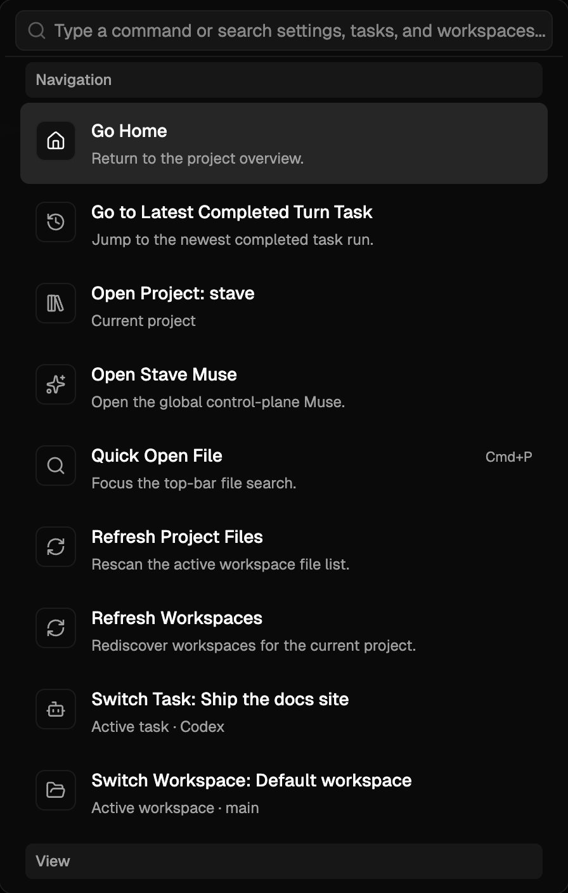

# Command Palette

Use the Command Palette when you know what you want to do in Stave but do not want to hunt through the UI first.

This example shows the global palette listing navigation, task, settings, and workspace actions in one searchable view.

## What It Is For

- Jump to app actions from anywhere in Stave.
- Open settings, switch views, create tasks, and move around the workspace without relying on the mouse.
- Reach the same action quickly even when you do not remember where the visible button lives.

## Open The Palette

- Press `Cmd/Ctrl+Shift+P`
- Or open it from the app chrome when a command-palette entry point is visible

The palette is global. You do not need to focus the chat composer first.

## Typical Commands

### Navigation

- quick open a file
- go home
- switch task, workspace, or repository
- refresh repository files or workspaces

### View

- toggle the workspace sidebar
- show or hide Explorer, Information, editor, or terminal surfaces

### Task

- create a new task
- stop the active turn
- **Open Review** for the active task, or **Back to conversation** while it
  shows [Review](review-mode.md)
- **Ask a side question** about the active task (Claude and Codex tasks;
  see [Side questions](side-questions.md))
- continue work in a new workspace
- open create-PR flow
- assign the task to an agent (**Assign to an agent…**: the composer's
  selector opens on **Agents**; with no task open, Kickoff opens)

### Provider And Settings

- switch between Claude and Codex
- jump straight to mapped models with `Alt+1..0`
- open Settings
- jump directly to a specific settings section
- open keyboard shortcuts

### External Workspace Actions

- reveal the active workspace
- open the active workspace in VS Code
- open the active workspace in Terminal

## Quick Start

1. Press `Cmd/Ctrl+Shift+P`.
2. Type a few words that describe the action you want, such as `terminal`, `settings`, `task`, or `workspace`.
3. Use the arrow keys to move through the results. The characters your
   words matched are marked in each result's name and description, and the
   result count is read out by screen readers as it changes.
4. Press `Enter` to run the selected action.

## How To Use It Well

### Jump To An Action You Use Often

1. Open the palette.
2. Type a short keyword such as `explorer`, `terminal`, or `new task`.
3. Run the command directly from the result list.

This is the fastest way to learn Stave's navigation model without memorizing every button location first.

### Open A Settings Section Directly

1. Open the palette.
2. Search for a settings area such as `providers`, `design`, or `shortcuts`.
3. Run the matching settings command.

This is usually faster than opening Settings and browsing manually.

### Reach An Option By Name

While you type, the palette also offers up to three **Options** from inside
commands: `Theme: <name>` for each theme, `Appearance: Light`, `Dark` or
`System`, and `New task in <repository>` for each repository you have opened
(another repository opens first, then the task starts there; if you go to a
different repository or workspace while it opens, no task is created). Typing an
option's exact name puts it first. Options do not appear with nothing typed,
and they are not pinned or kept in Recent.

### Jump Straight To A Model

1. Press `Alt+1`, `Alt+2`, or any mapped `Alt+1..0` slot.
2. Stave switches the active task to the mapped provider and model immediately.
3. Open `Settings -> Command Palette` to change the assignments.

Default bindings:

- `Alt+1` → `Claude Opus 5` (Claude default)
- `Alt+2` → `GPT-5.6 Sol` (Codex default)
- `Alt+3` → `Claude Fable 5.2` (Claude frontier)
- `Alt+4` → `GPT-6 Astra` (Codex frontier)

The same four bindings back the model picker's **Recommended** group.

### Work Mostly From The Keyboard

- Keep the palette for app-level actions.
- Keep slash commands in the prompt composer for provider-specific prompt behavior.

That separation matters: the Command Palette controls Stave itself, while slash commands affect what the model does inside a task.

### Find A Task In Any Repository

The switch under the search field sets where the palette looks for tasks (Tab
reaches it once, the arrow keys change it, and clicking it keeps you typing):

- **This workspace** (the default) lists the open workspace's tasks.
- **All repositories** searches every task of every registered repository and
  its workspaces, including workspaces you have not opened since Stave started.
  The words you type are matched against task titles and the names of the
  workspace, its branch and the repository; matching titles come first, then
  the most recent. With nothing typed it lists the latest tasks.

Each result shows its repository, workspace, branch and folder, so tasks with
the same title are told apart, plus its state (Running, Done, Failed, Stopped,
New) and its last activity. Opening one goes to its repository, then its
workspace, then the task. The title group excludes archived and delegated tasks. Repositories you removed are not searched. The other commands, Fleet View included, stay in the list in both
scopes.

### Find Words In Messages

Type at least two characters to see **In messages** below the task-title
results. It searches local user messages, assistant replies and readable tool
summaries across registered repositories. Korean and partial words match.
Results show a highlighted snippet, match count, last activity and task state.
Archived and delegated tasks are included and labelled; delegated results link
to their parent. Enter opens the task at the matching message, loading an older
history window when needed. Opening a result marks its notifications read. Archived results remain read-only with an **Archived · Restore** banner until restored. Search does not contact a provider.

Existing history is indexed in short background batches. While indexing, a
progress notice explains that results are still being built. Raw tool payloads,
attachment bytes and secret metadata are excluded.

In Fleet, turn on **Include message text** beside search to find the same
content and open its matching message. In a conversation, **Cmd/Ctrl+F** searches
loaded live text and local index hits for history outside the loaded window, with each message shown once. Use **Load newer
messages** to return through newer history after jumping to an old match.

### Stave Slash Commands

Stave answers these itself; they are never sent to the provider. They are
listed under **Stave commands** when you type `/` in the composer.

| Command | What it does |
| --- | --- |
| `/aside <question>` | Ask a [side question](side-questions.md) about the task without interrupting it. The answer appears beside the conversation; nothing is added to the conversation or your draft. |

## Related Shortcuts

The full list is in [Keyboard Shortcuts](keyboard-shortcuts.md), and in the app:
press `Cmd/Ctrl+/` or run **Open keyboard shortcuts** from the palette.

- `Cmd/Ctrl+P` focuses file quick open in the top bar.
- `Cmd/Ctrl+,` opens the main Settings dialog.
- `Cmd/Ctrl+K` then `H` goes home.
- `Cmd/Ctrl+K` then `F`, `A`, `T`, or `G` opens Fleet View, Schedules, Issues, or Agents.
- `Cmd/Ctrl+K` then `B` toggles the left workspace sidebar.
- `Cmd/Ctrl+K` then `C` toggles the source control (changes) panel.
- `Cmd/Ctrl+K` then `E` opens Explorer.
- `Cmd/Ctrl+K` then `I` toggles the Information panel.
- `Cmd/Ctrl+K` then `S` opens Workspace Tools, and `Cmd/Ctrl+K` then `L` opens a Lens tab.
- `Cmd/Ctrl+K` then `\` focuses the editor, and `Cmd/Ctrl+K` then `` ` `` toggles the terminal.
- The letter after `Cmd/Ctrl+K` is the default; change it under Settings → Keyboard & Commands.
- `Cmd/Ctrl+Shift+T` reopens the tab you closed last; `Cmd/Ctrl+[` and `Cmd/Ctrl+]` go back and forward.
- `Alt+P` opens the prompt model selector.
- `Alt+1..0` selects your mapped prompt models.

## Troubleshooting

### I expected a slash command result

- Symptom: you search for a provider slash command in the Command Palette and do not see the result you want.
- Cause: slash commands belong to the prompt composer, not the global palette.
- Fix: place the cursor in the prompt composer and use the provider's slash-command flow there.

### I cannot remember the exact command name

- Symptom: the result list does not show what you expected.
- Cause: you searched too narrowly.
- Fix: try broader words such as `terminal`, `workspace`, `provider`, or `settings` instead of the full label.

## Related Docs

- [Keyboard Shortcuts](keyboard-shortcuts.md)
- [Integrated Terminal](integrated-terminal.md)
- [Runtime Safety Controls](provider-sandbox-and-approval.md)
- [AgentRuns](agent-runs.md)

Message search also includes archived workspaces. These hits show Archived and open a read-only history view. Restore restores the workspace through the cleanup center before returning to an editable task. Permanent workspace deletion removes its message-search index entries.
