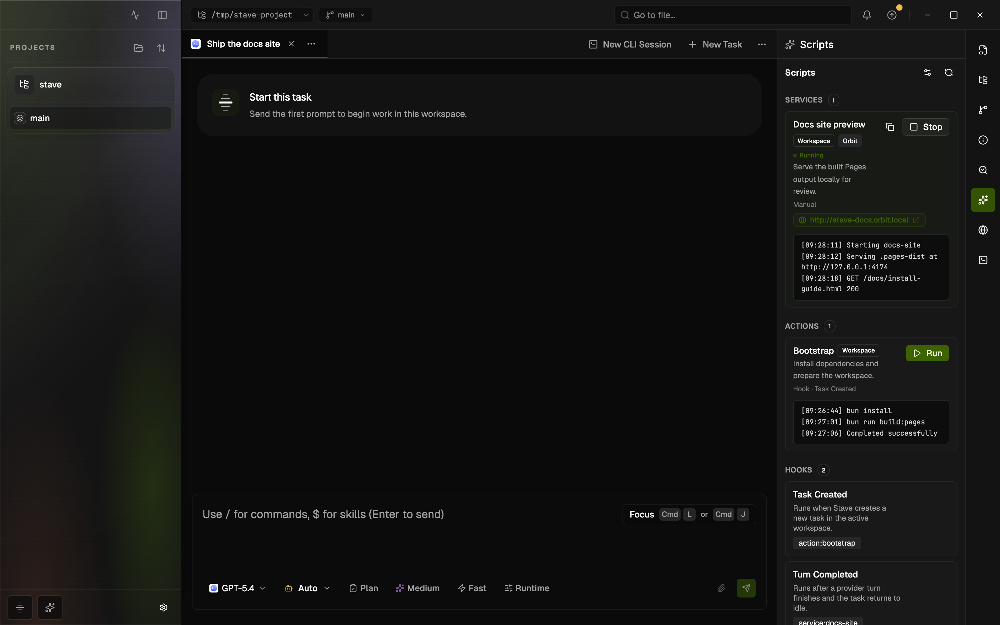

# Workspace Scripts

## Summary

- Workspace Tools let Stave run one-shot commands, long-running processes such as dev servers, and lifecycle triggers from the right rail.
- The editor lives under `Settings > Projects > Workspace Tools`. Its `Processes`, `Commands`, `Triggers`, and `Environments` tabs edit the shared `services`, `actions`, `hooks`, and `targets` in `.stave/scripts.json` without exposing a raw JSON editor.
- Script execution runs through the isolated desktop host-service child process, which keeps long-lived output and trigger churn off the Electron main-process event loop.



This rendered example shows the right-rail Workspace Tools panel with a running local docs preview process, a completed bootstrap command, and trigger wiring for the current workspace.

## When To Use It

- Use this when a workspace needs repeatable setup commands, dev servers, or task/turn/PR lifecycle triggers.
- Use it when you want teammates to share the same commands and processes through the Stave UI.
- Edit the JSON by hand instead when you need `.stave/scripts.local.json` overrides or fields the editor does not show.

## Before You Start

- Open a repository in Stave and select a workspace.
- Make sure the workspace has write access to its `.stave/` folder.
- If you need repository-wide scripts, decide whether the config should live in the repository root or in the active workspace.
- Workspace-level shared config is editable when that repository is the current repository in Stave.

## Quick Start

1. Open `Settings > Projects > Workspace Tools`.
2. Pick the repository in the project picker at the top of the page.
3. Choose `Repository` or `Workspace` under `Config Scope`. Use `Create config` if that file does not exist yet.
4. Click `Add process` on the `Processes` tab or `Add command` on the `Commands` tab, fill in the label and commands, then click `Save changes`.
5. On the `Triggers` tab, use `Assign command or process` under `Task Created`, `Task Archiving`, `Turn Started`, `Turn Completed`, `PR Before Open`, or `PR After Open` if the entry should run from that event (stored as `task.created`, `task.archiving`, `turn.started`, `turn.completed`, `pr.beforeOpen`, and `pr.afterOpen`).
6. Open `Workspace Tools` in the right rail to run the entry and verify the merged runtime for the current workspace.

## Interface Walkthrough

### Entry Points

- Open `Settings > Projects > Workspace Tools`, pick a repository in the project picker, and edit the shared config in its tabs.
- Open the right rail and select `Workspace Tools` to inspect the merged runtime for the active workspace.
- The runtime panel has `Processes`, `Commands`, `Triggers`, and `Runs` views, shows which config each entry comes from, and links back to the settings.

### Key Controls

- `Config Scope`: chooses which shared `.stave/scripts.json` file the editor changes, `Repository` or `Workspace`.
- `Add process`: creates a long-running process, such as a dev server, that you start and stop from the panel. Stored under `services`.
- `Add command`: creates a one-shot command sequence. Stored under `actions`.
- `Triggers`: assigns commands or processes to lifecycle triggers. Stored under `hooks`.
- `Environments`: defines the working directory, shell, and environment variables that commands and processes run with. Stored under `targets`.
- `Save changes`: writes the selected shared config file.
- `Reload`: re-reads the selected config file from disk.
- `Discard`: throws away unsaved changes and reloads the file.
- `Open Workspace tools settings`: opens `Settings > Projects > Workspace Tools` from the right-rail panel.
- `Refresh Workspace tools`: reloads the effective runtime for the active workspace.

## Common Workflows

### Create A Command

1. Open `Settings > Projects > Workspace Tools`, select the `Commands` tab, and click `Add command`.
2. Enter a `Label`. The `ID` is generated from it; open `Advanced` and click `Edit` next to the ID to set a stable id such as `bootstrap` or `test-ci`.
3. Under `Advanced`, add a `Description` if the label is not enough.
4. Under `Advanced`, choose an `Environment`:
   - `Workspace` runs inside the active workspace path.
   - `Repository` runs in the repository root.
5. Enter one shell command per line in `Commands`.
6. Click `Save changes`, then run the command from the `Commands` view in the right-rail `Workspace Tools` panel.

### Create A Process

1. Open `Settings > Projects > Workspace Tools`, select the `Processes` tab, and click `Add process`.
2. Enter a label and one or more commands.
3. Set `Restart on run` if Stave should replace an existing running process when you run it again.
4. Under `Advanced`, enable `Use Orbit` when the process should run through `portless` and expose an Orbit URL.
5. Optionally set `Orbit Name`, `Orbit Proxy Port`, or `Plain HTTP` for local routing preferences.
6. Click `Save changes`, then start and stop the process from the `Processes` view in the right-rail `Workspace Tools` panel.

Orbit works best when the process command is a direct dev-server command such as `yarn start`, `pnpm dev`, or `bun run dev`.
For those commands, Stave passes the argv directly to `portless run`, which lets Portless assign an ephemeral app port and inject `--port` / `--host` flags for supported frameworks.
If the command relies on shell-only syntax such as `&&`, pipes, redirects, command substitution, or inline env assignments, Stave falls back to a shell wrapper and the underlying app must still honor `PORT` / `HOST` on its own.

### Assign A Trigger

1. Open `Settings > Projects > Workspace Tools` and select the `Triggers` tab.
2. Find the trigger you need.
3. Click `Assign command or process` and pick the entry to run.
4. Leave `Blocking` on when failures should stop the parent workflow, or turn it off for best-effort execution. `Remove assignment` unlinks the entry.
5. Click `Save changes`, then test the trigger with `Run` in the `Triggers` view of the right-rail panel.

### Verify The Runtime

1. Save the changes in `Settings > Projects > Workspace Tools`.
2. Open `Workspace Tools` in the right rail and use `Refresh Workspace tools`.
3. Run the command, process, or trigger.
4. Inspect the live status badge, error message, and log output in the panel; the `Runs` view keeps recent output.

## Files And Data

- Shared repository config: `<repository>/.stave/scripts.json`
- Shared workspace config: `<workspace>/.stave/scripts.json`
- Optional advanced local override: `<repository-or-workspace>/.stave/scripts.local.json`

Minimal shared config example:

```json
{
  "version": 2,
  "actions": {
    "bootstrap": {
      "label": "Bootstrap",
      "description": "Install dependencies and prepare the workspace.",
      "commands": [
        "bun install",
        "bun run db:prepare"
      ],
      "target": "workspace"
    }
  },
  "services": {
    "app": {
      "commands": [
        "bun run dev"
      ],
      "target": "workspace",
      "orbit": {
        "enabled": true,
        "name": "stave"
      }
    }
  },
  "hooks": {
      "task.created": [
        {
          "ref": "bootstrap",
          "kind": "action"
        }
      ]
  }
}
```

## Limitations And Advanced Options

- The editor changes only shared `.stave/scripts.json` files.
- The editor does not change `.stave/scripts.local.json`; edit that file by hand.
- Orbit processes require the `Workspace` environment.
- Legacy `workspace.created` and `workspace.archiving` hooks remain supported for older configs, but new script flows should prefer task and turn triggers.
- If you need per-developer overrides or JSON fields the editor does not show, edit the file manually.
- When both workspace and repository shared configs exist, the workspace shared config wins for the active workspace.

## Troubleshooting

### Workspace Tools Settings Show A File Error

- Symptom: `Settings > Projects > Workspace Tools` shows invalid JSON or schema errors.
- Cause: the existing config file is not valid `version: 2` scripts JSON.
- Fix: correct the file manually, then click `Reload`.

### The Runtime View Does Not Change After Saving

- Symptom: the right-rail `Workspace Tools` panel still shows older entries.
- Cause: a higher-priority workspace shared config is overriding the repository shared config for the current workspace.
- Fix: check the selected `Config Scope` in `Settings > Projects > Workspace Tools`, then refresh the runtime panel.

### An Orbit Process Still Crashes With `port already in use`

- Symptom: an Orbit-enabled process still tries to bind a fixed port such as `8888` and exits.
- Cause: the underlying app ignores `PORT` / `HOST`, or the configured command uses shell syntax that prevents Portless from applying its normal direct-command port injection path.
- Fix: prefer a direct command such as `yarn start` or `pnpm dev` instead of shell chains, or update the app script so it respects `PORT`.

### A Trigger Assignment Is Marked As Unresolved

- Symptom: the `Triggers` tab shows preserved unresolved hook refs.
- Cause: a trigger references a command or process that is not available in the current merged entry list.
- Fix: restore the missing entry, correct the ref id manually, or remove the unresolved assignment.

## Related Docs

- [Repository Instructions](repository-instructions.md)
- [Local MCP user guide](local-mcp-user-guide.md)
- [Command Palette](command-palette.md)
